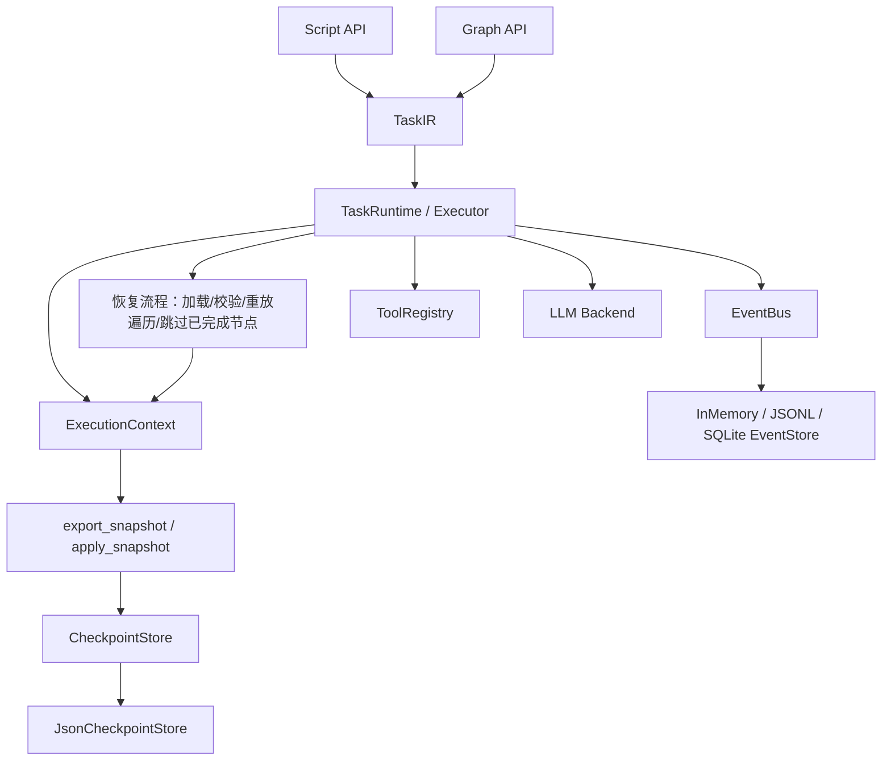

# P1 需求追溯与设计偏差说明

本文档把《需求规格说明书_p1阶段.docx》（内部基线，未随仓库发布）的 FR/AT 编号映射到当前实现和测试，并显式记录有意为之的设计偏差。它用于论文、答辩和后续维护，不替代需求文档本身。

## 1. 逻辑架构

说明：

- `RecoveryManager` 的职责由 `TaskRuntime` 内部方法承担（加载/校验检查点、重建上下文、恢复续跑），没有单独的类。这样可以保证脚本、图、恢复只有一条执行路径。
- `CheckpointStore` 只负责持久化、读取和完整性校验，不解释任务语义。
- `ExecutionContext` 只负责状态、快照和运行时调用，不决定步骤如何执行。

## 2. 功能需求映射

状态说明：

- **满足**：实现与需求意图一致；
- **部分**：核心行为满足，但字段/边界/测试仍有差异；
- **设计偏差**：实现采用了不同的结构或语义，但已说明理由。

| 编号 | 状态 | 实现位置 | 测试/说明 |
|---|---|---|---|
| FR-001 | 满足 | `executor.py`、`events.py` | 原有 49 个 P0 用例通过 |
| FR-002 | 满足 | `models.py` 的 `ExecutionEvent.task_id/step_id`；`EventBus` 自动注入 | `test_events_carry_task_and_step_ids` |
| FR-003 | 满足 | `ExecutionEvent.duration_ms`；步骤/LLM/工具事件 | `test_event_diagnostics_fields` |
| FR-004 | 满足 | `attempt`、`ERROR_OCCURRED`、`RETRY_SCHEDULED`、`TASK_FAILED` | 既有重试测试 |
| FR-005 | 满足 | 保留细粒度 `E_*` 错误码 + 第 4 节类别映射 | 不维护两套异常体系 |
| FR-006 | 满足 | `CHECKPOINT_SAVED`、`CHECKPOINT_LOADED`、`TASK_RESUMED`、`RECOVERY_FAILED` | `test_resume_failure_emits_recovery_event` |
| FR-007 | 满足 | `run()` 先发 `TASK_COMPLETED` 再转 `SUCCEEDED`；任何 sink 失败在结束时转 `E_EVENT_LOG` | `test_task_completed_sink_failure...`、`test_event_sink_failure_always_marks_failed` |
| FR-008 | 满足 | `redaction.py`；`EventBus` 对 payload 递归脱敏；`JsonCheckpointStore` 默认 AES-GCM 加密 | `test_event_payload_redacts_sensitive_fields`、`test_tool_events_redact_sensitive_input_and_output`、`test_checkpoint_is_encrypted_on_disk`；事件脱敏仍是启发式 |
| FR-009 | 满足 | `ExecutionContext.export_snapshot()` | `test_snapshot_roundtrip_and_non_json_state` |
| FR-010 | 满足 | 快照包含 `task_id/run_id/status/state/step_results/completed_steps/elapsed_seconds/...` | `step_results` 为 `state` 的派生只读视图；`test_checkpoint_step_results_and_content_hash` |
| FR-011 | 满足 | `apply_snapshot()` / `from_snapshot()` | 快照往返测试 |
| FR-012 | 满足 | `StateSerializationError`；严格 JSON 往返 | 快照测试 |
| FR-013 | 满足 | 恢复 `state`、`completed_steps`、`next_step_id`、计数器 | 恢复测试 |
| FR-014 | 满足 | `CheckpointStore.save()` | store roundtrip |
| FR-015 | 满足 | `load_latest(run_id, task_id)` | store roundtrip |
| FR-016 | 满足 | `checkpoint_version`、`task_version`（由 `spec_hash` 派生）、`created_at` | `test_resume_skips_completed_steps` |
| FR-017 | 满足 | JSON/schema/版本/plan/spec hash/`content_hash` 校验 | 损坏、版本、hash、篡改测试 |
| FR-018 | 满足 | 临时文件 + `fsync` + `os.replace` | 存储实现；未做多进程并发锁 |
| FR-019 | 满足 | 按 run 分目录 + `run_id` 校验 | store 测试 |
| FR-020 | 满足 | `TaskRuntime.resume(run_id=...)` / `checkpoint_id` | 恢复测试 |
| FR-021 | 满足 | `load_latest` + `_resolve_resume_checkpoint` | 恢复测试 |
| FR-022 | 满足 | 重放遍历 + `STEP_SKIPPED` + 路径一致性校验 | `test_resume_skips_completed_steps`、`test_random_dag_resume_preserves_calls_and_output` |
| FR-023 | 满足 | `task_id`、协议主版本、`plan_hash`、`spec_hash` | 计划/任务定义变化测试 |
| FR-024 | 满足 | `CheckpointNotFoundError` | `test_resume_failure_emits_recovery_event` |
| FR-025 | 满足 | 输出 Schema、重试、步数/模型调用上限继续生效；`elapsed_seconds` 计算剩余超时预算 | `test_resume_respects_total_timeout_budget` |
| FR-026 | 满足 | 非幂等工具 + `UNKNOWN` → `E_RESUME_UNSUPPORTED` | `test_non_idempotent_unknown_result_blocks_resume` |
| FR-027 | 满足 | 两种 API 共用 `Checkpoint` 和 `TaskRuntime` | 架构与测试 |
| FR-028 | 满足 | 统一 `resume` 入口 | 恢复测试 |
| FR-029 | 满足 | 同一确定任务恢复后比较输出/状态/调用行为 | `test_script_and_graph_resume_are_equivalent` |

## 3. 验收测试映射

| 用例 | 状态 | 对应测试 |
|---|---|---|
| AT-001 正常任务 | 满足 | 原有正常执行测试 |
| AT-002 工具异常定位 | 满足 | 工具错误/事件测试 |
| AT-003 快照导出导入 | 满足 | `test_snapshot_roundtrip_and_non_json_state` |
| AT-004 检查点保存读取 | 满足 | `test_json_checkpoint_store_roundtrip_and_latest` |
| AT-005 前两步成功、第三步失败后恢复 | 满足 | `test_at005_first_two_succeed_third_fails_then_resume` |
| AT-006 损坏检查点 | 满足 | `test_corrupted_checkpoint_is_rejected` |
| AT-007 不兼容任务版本 | 满足 | `test_resume_rejects_changed_plan`、`test_resume_rejects_changed_spec` |
| AT-008 检查点保存失败 | 满足 | `test_checkpoint_save_failure_does_not_retry_step` |
| AT-009 恢复后输出 Schema | 满足 | 恢复任务统一经过 `_execute_end` 校验 |
| AT-010 双模式等价 | 满足 | `test_script_and_graph_resume_are_equivalent` |
| AT-011 日志不含敏感凭据 | 部分 | `test_event_payload_redacts_sensitive_fields`、`test_tool_events_redact_sensitive_input_and_output`；脱敏为启发式 |
| AT-012 不确定副作用不重复 | 满足 | `test_non_idempotent_unknown_result_blocks_resume` |

## 4. 错误类别映射

保留细粒度错误码，同时给出与需求文档建议类别的映射：

| 需求建议类别 | 当前错误码 |
|---|---|
| VALIDATION_ERROR | `E_CONTRACT_INPUT`、`E_CONTRACT_OUTPUT`、`E_STATE_SERIALIZATION`、`E_STATE_INVALID` |
| TOOL_ERROR | `E_TOOL_CALL`、`W_NON_IDEMPOTENT` |
| MODEL_ERROR | `E_MODEL_CALL`、`E_STRUCTURED_OUTPUT` |
| TIMEOUT_ERROR | `E_STEP_TIMEOUT`、`E_TASK_TIMEOUT` |
| STEP_LIMIT_EXCEEDED | `E_LIMIT_EXCEEDED` |
| CHECKPOINT_ERROR | `E_CHECKPOINT`、`E_CHECKPOINT_NOT_FOUND`、`E_CHECKPOINT_INVALID`、`E_CHECKPOINT_INCOMPATIBLE`、`E_CHECKPOINT_IO`、`E_RESUME_UNSUPPORTED` |
| EXECUTION_ERROR | `E_FRAMEWORK`、`E_PLAN_INVALID`、`E_BUSINESS_RULE`、`E_CANCELLED`、`E_TERMINATION`、`E_BRANCH_CONDITION`、`E_EVENT_LOG` |

## 5. 设计偏差与理由

| 文档建议 | 当前实现 | 理由 |
|---|---|---|
| 独立 `RecoveryManager` 类 | 恢复逻辑内聚在 `TaskRuntime` | 避免脚本/图/恢复三套执行路径，降低不一致风险 |
| `step_results` + `state_snapshot` 两份数据 | `state` 是唯一事实来源；`step_results` 是导出的派生只读视图 | 兼顾文档结构与一致性；读取时校验派生结果与 `state` 一致 |
| 恢复复用同一 `run_id` | 新 `TaskRun` + `resumed_from_run_id` | `FAILED/CANCELLED` 是 P0 终态；新 run 更符合状态机，同时保留 lineage |
| 以 `next_step_id` 作为唯一恢复位置 | 重放遍历 + 跳过已完成节点；`next_step_id` 用于诊断/一致性校验 | 对分支/汇合更鲁棒，不需要序列化执行器内部集合 |
| `task_version` 为人工版本号 | `task_version = spec_hash[:16]` | 内容派生，避免忘记更新版本号；完整 `spec_hash` 仍用于兼容校验 |
| 粗粒度错误分类 | 保留细粒度 `E_*` 错误码 | 诊断能力更强；需求意图（统一分类）已满足，只是粒度更细 |
| 恢复后的 `timeout_seconds` 为原预算 | `elapsed_seconds` 累计执行时间，恢复时使用剩余预算 | 停机时间不计入；这是执行时间预算，不是墙钟时间预算 |
| 全量敏感信息脱敏 | 常见凭据字段 + 明显密钥文本模式 | 原型阶段避免过度脱敏影响调试；工具作者仍应避免把秘密放进业务字段 |

## 6. 非功能需求

| 编号 | 状态 | 说明 |
|---|---|---|
| NFR-001 兼容性 | 满足 | 关闭检查点时原有 49 个 P0 用例全部通过 |
| NFR-002 正确性 | 满足 | 快照/检查点恢复测试覆盖状态、步骤结果和计数器 |
| NFR-003 可诊断性 | 满足 | 恢复预检查失败有 `RECOVERY_FAILED` 事件和明确错误码 |
| NFR-004 安全性 | 满足 | 事件轻量脱敏；检查点默认 AES-GCM 加密（密钥来自环境/本地 0600 key）；不反序列化任意对象；业务秘密仍需工具作者规避 |
| NFR-005 可测试性 | 满足 | 存储、快照、恢复、执行器路径均有独立测试 |
| NFR-006 可维护性 | 满足 | `checkpoint_version=1`，不兼容版本显式拒绝 |
| NFR-007 性能 | 基本完成（最小基准） | `bench/p1_benchmark.py` 报告检查点开销、文件大小、恢复耗时和重复调用数；完整对照实验留到论文实验阶段 |

## 7. 后续建议

1. 如需要更强的安全检查，扩展 `redaction.py` 的规则。
2. 论文实验阶段补充与基线/LangGraph 的对照、更多任务规模和真实模型测量。
3. 显式暂停/人工审批恢复、执行回放等 P1.5 能力另行规划。
